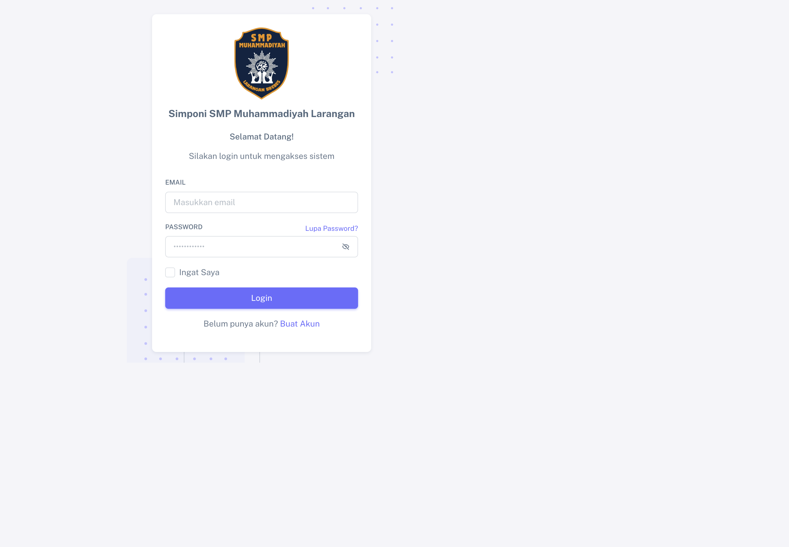
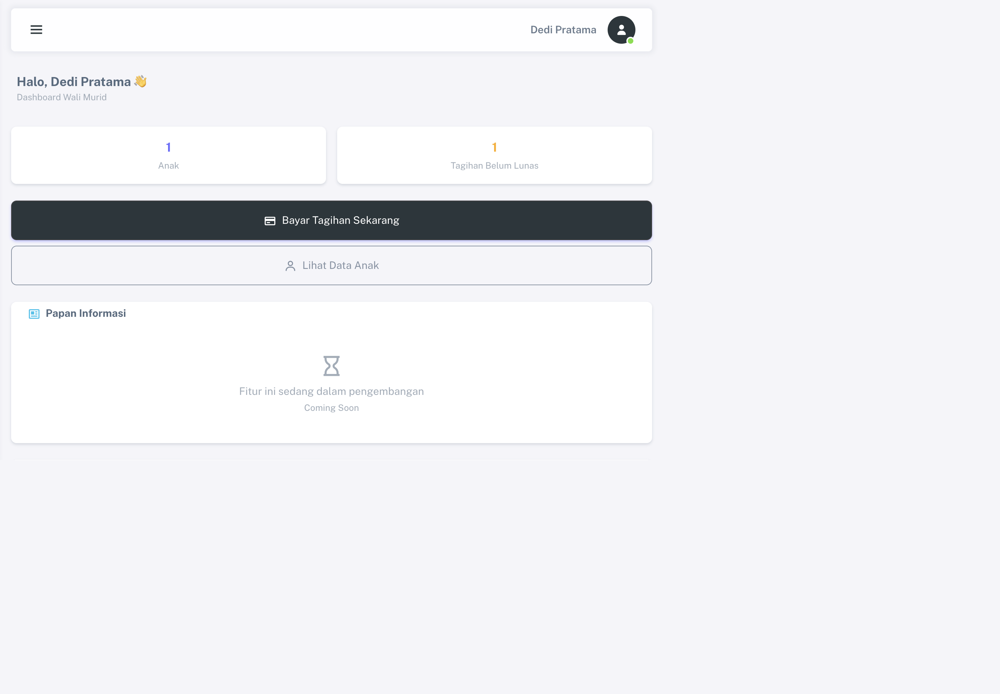
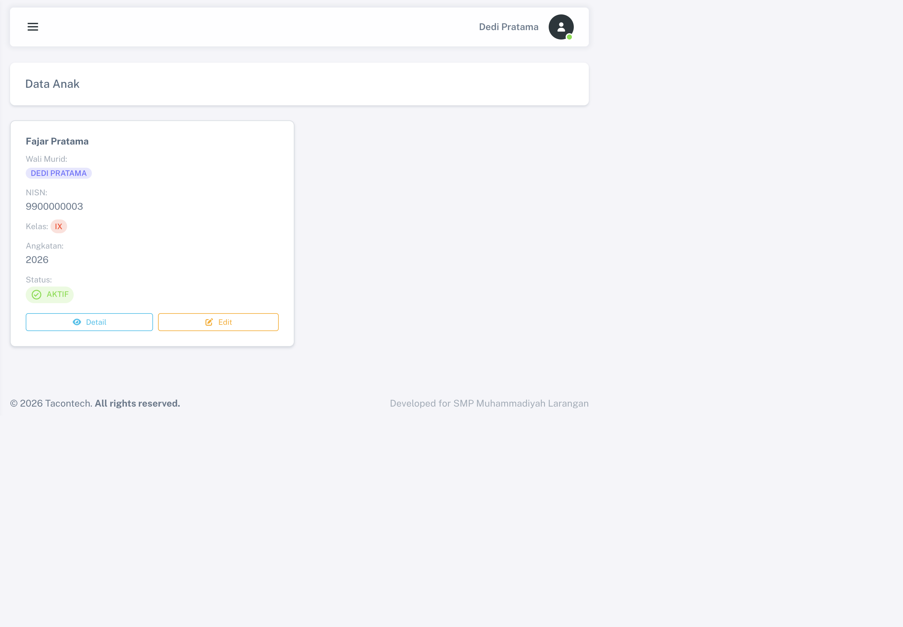
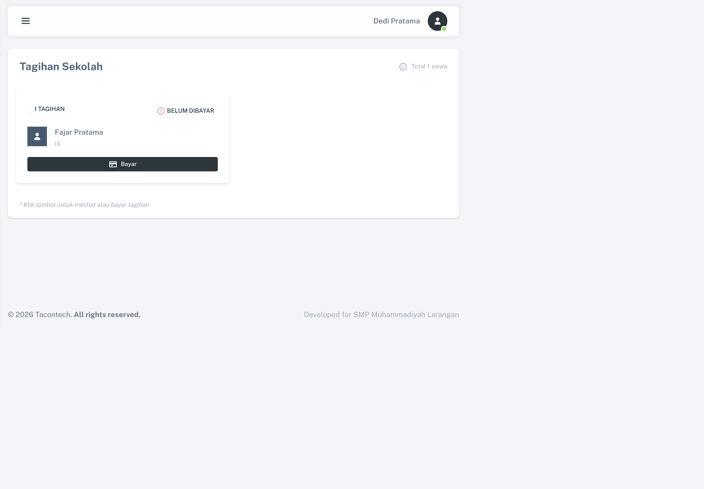
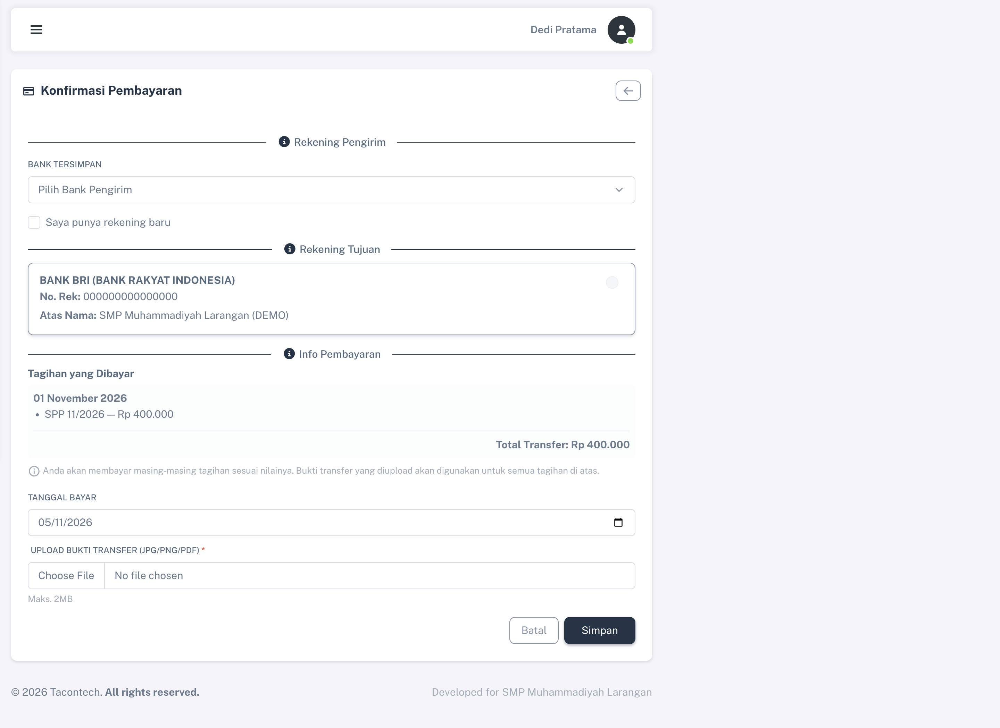

<div align="center">
  

  # SIMPONI

  ### Sistem Informasi Pembayaran dan Operasional Sekolah

  **SMP Muhammadiyah Larangan (ESMULA)**

  <p>
    Aplikasi web untuk mengelola data siswa, tagihan sekolah, pembayaran transfer, dan verifikasi pembayaran dalam satu alur yang saling terhubung.
  </p>
</div>

---

## Tentang aplikasi

SIMPONI membantu sekolah mengelola administrasi pembayaran siswa dan menyediakan akses mandiri bagi wali murid. Operator membuat data biaya dan tagihan; wali melihat tagihan untuk siswa yang terhubung dengan akunnya, lalu mengirim klaim pembayaran beserta bukti transfer; operator memeriksa dan mengonfirmasi pembayaran.

> **Status pembayaran:** aplikasi saat ini mendukung pencatatan transfer manual dan verifikasi oleh operator. Integrasi payment gateway dan konfirmasi otomatis belum tersedia.

## Tampilan aplikasi

Screenshot di bawah diambil dari aplikasi lokal menggunakan akun dan data demo. Informasi rekening pada layar pembayaran adalah data fiktif untuk demonstrasi, bukan rekening untuk transaksi nyata.

### Login



### Dashboard wali murid

Dashboard menampilkan ringkasan anak yang terhubung, jumlah tagihan yang belum lunas, dan pintasan ke data anak serta pembayaran.



### Data anak

Wali dapat melihat identitas siswa yang terhubung, termasuk kelas, angkatan, dan status siswa.



### Tagihan sekolah

Tagihan ditampilkan berdasarkan siswa yang berada dalam akun wali. Dari halaman ini wali dapat membuka rincian tagihan atau melanjutkan ke pembayaran.



### Pengajuan pembayaran

Form pembayaran menampilkan rekening pengirim dan tujuan, rincian tagihan, total transfer, tanggal pembayaran, serta unggahan bukti transfer.



## Fitur utama

### Administrasi sekolah

- Dashboard untuk melihat ringkasan operasional.
- Pengelolaan akun admin, operator, dan wali murid.
- Pengelolaan data siswa, status, kelas, angkatan, dan relasi wali.
- Pengelolaan jenis biaya dan nominal pembayaran.
- Pembuatan tagihan per siswa dengan rincian biaya dan tanggal jatuh tempo.
- Pemantauan pembayaran, konfirmasi transfer, dan pencetakan invoice.
- Pengelolaan rekening sekolah serta referensi bank Indonesia.
- Fitur ekspor data untuk kebutuhan administrasi yang tersedia di aplikasi.

### Portal wali murid

- Melihat dashboard, data anak, dan tagihan yang terkait dengan akun wali.
- Melihat rincian tagihan serta invoice siswa.
- Mengajukan pembayaran transfer manual dan mengunggah bukti pembayaran.
- Melihat profil akun wali.

## Peran pengguna

| Peran | Tanggung jawab |
|---|---|
| **Admin** | Administrasi utama dan pengelolaan akses sistem. |
| **Operator** | Mengelola wali, siswa, biaya, tagihan, rekening sekolah, dan verifikasi pembayaran. |
| **Wali** | Melihat data siswa yang terhubung, tagihan, profil, dan mengajukan klaim pembayaran. |

Akses halaman dibatasi berdasarkan sesi login dan peran. Satu wali dapat terhubung dengan beberapa siswa; setiap siswa menyimpan relasi ke wali yang bertanggung jawab.

## Alur data dan pembayaran

```text
Admin/Operator
    ├── membuat biaya dan data siswa
    ├── membuat tagihan + rincian nominal
    └── memeriksa klaim pembayaran
              ▲
              │ status dikonfirmasi operator
              │
Wali ── melihat tagihan siswa tertaut
     └── mengirim tanggal bayar + bukti transfer
```

- `users` menyimpan akun dan peran pengguna.
- `siswas` menyimpan identitas siswa dan relasi wali.
- `biayas` menyimpan jenis biaya yang dikelola sekolah.
- `tagihans` menyimpan tagihan per siswa, periode, tanggal jatuh tempo, dan status.
- `tagihan_details` menyimpan rincian nama biaya dan nominal pada saat tagihan dibuat.
- `pembayarans` menyimpan klaim pembayaran, bukti transfer, dan hasil konfirmasi.
- `wali_banks`, `bank_sekolahs`, dan `banks` menyimpan rekening serta katalog bank yang digunakan pada alur pembayaran.

Status tagihan yang digunakan aplikasi meliputi `baru`, `angsur`, dan `lunas`. Pengajuan wali merupakan klaim transfer; status lunas hanya mengikuti proses konfirmasi operator.

## Teknologi

| Komponen | Teknologi |
|---|---|
| Backend | PHP `^8.0.2`, Laravel `^9.19` |
| UI | Blade, Bootstrap 5, template Sneat |
| Database | MySQL atau MariaDB |
| Aset frontend | Node.js, npm, Vite 3 |
| Tes | PHPUnit 9 |
| Fitur terkait pembayaran | Laravel DomPDF, katalog bank Indonesia |

## Menjalankan secara lokal

### Prasyarat

- PHP 8.0.2 atau lebih baru dan ekstensi yang dibutuhkan Laravel.
- Composer.
- Node.js dan npm.
- MySQL atau MariaDB.

### Instalasi

1. Clone repository dan masuk ke direktori proyek.

   ```bash
   git clone https://github.com/umarulkhak/simponi-esmula-2026-v2-.git
   cd simponi-esmula-2026-v2-
   ```

2. Pasang dependensi PHP dan frontend.

   ```bash
   composer install
   npm ci
   ```

3. Siapkan konfigurasi lokal.

   ```bash
   cp .env.example .env
   ```

   Atur setidaknya `APP_URL`, koneksi database (`DB_HOST`, `DB_PORT`, `DB_DATABASE`, `DB_USERNAME`, `DB_PASSWORD`), dan nilai berikut pada `.env` lokal:

   ```dotenv
   ADMIN_DEFAULT_NAME=
   ADMIN_DEFAULT_EMAIL=
   ADMIN_DEFAULT_PASSWORD=
   DEMO_WALI_PASSWORD=
   ```

   Isi nilai tersebut dengan identitas dan kata sandi khusus untuk lingkungan lokal. Jangan menaruh `.env` atau kredensial asli di repository.

4. Buat database MySQL/MariaDB sesuai `DB_DATABASE`, lalu buat application key.

   ```bash
   php artisan key:generate
   ```

5. Jalankan migrasi dan seeder.

   ```bash
   php artisan migrate --seed
   ```

   Seeder menyiapkan katalog bank dan data demo rekening sekolah, wali, siswa, serta tagihan yang saling terhubung. Data demo wali/siswa/tagihan dibatasi untuk environment `local` dan `testing`.

6. Bangun aset dan jalankan aplikasi.

   ```bash
   npm run build
   php artisan serve
   ```

   Buka `http://127.0.0.1:8000`.

Untuk pengembangan frontend dengan hot reload, gunakan `npm run dev` pada terminal terpisah.

## Menjalankan tes

```bash
vendor/bin/phpunit
```

Hasil QA lokal terakhir:

| Pemeriksaan | Hasil |
|---|---|
| PHPUnit | **Lulus** — 8 tes, 94 assertions |
| Build frontend | **Lulus** — `npm run build`, Vite 3.2.11 |
| Migrasi | Semua migrasi berstatus `Ran` pada database QA |
| Browser | Halaman login dan halaman utama wali yang diuji merespons HTTP 200 |
| Relasi rekening pembayaran | 0 referensi rekening wali/sekolah yang yatim pada data QA |
| Audit dependency produksi | 0 temuan dari `npm audit --omit=dev` |

Laporan QA lengkap dan batas cakupannya ada di [`docs/QA-REPORT-NOTION.md`](docs/QA-REPORT-NOTION.md).

## Batasan dan kesiapan produksi

- Pembayaran dilakukan melalui transfer manual; tidak ada integrasi payment gateway.
- Papan informasi wali masih dalam pengembangan.
- Akun wali baru perlu dihubungkan dengan siswa oleh admin/operator.
- Reset kata sandi/email, pengiriman email produksi, dan operasi destruktif memerlukan pengujian serta konfigurasi tambahan.
- Audit semua dependency npm pada pemeriksaan QA menemukan 15 temuan pada dependency pengembangan (4 moderate, 10 high, 1 critical). Tinjau dan perbarui dependency secara terencana sebelum rilis produksi; audit dependency produksi pada saat pemeriksaan tidak menemukan kerentanan.
- Untuk deployment, gunakan kredensial unik, HTTPS, `APP_DEBUG=false`, penyimpanan bukti pembayaran yang terlindungi, backup database, kebijakan retensi data, dan pengujian di staging.
- Jangan memakai rekening, akun, atau transaksi seed/demo untuk pembayaran sungguhan.

## Dokumentasi tambahan

- [Laporan QA lengkap](docs/QA-REPORT-NOTION.md)
- [Arsitektur aplikasi](docs/ARCHITECTURE.md)
